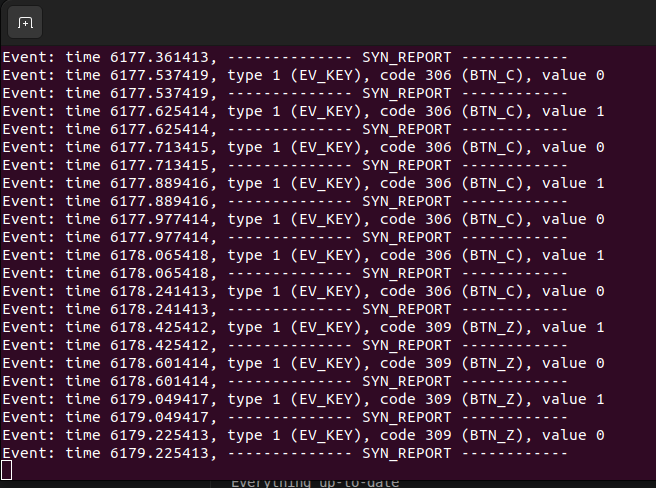

# Build and Test on i.MX93 FRDM

## Prepare the kernel

Run these commands from the root of `linux-kernel-labs-imx93`. Use a clean Linux checkout and apply the patches in order on top of the stable tag `v6.12.103`.

```bash
lab_repo="$PWD"
kernel=/path/to/linux
git -C "$kernel" switch --detach v6.12.103

for patch in "$lab_repo"/kernel-patches/*.patch; do
    git -C "$kernel" apply "$patch" || exit 1
done

export ARCH=arm64 CROSS_COMPILE=aarch64-linux-gnu-
make -C "$kernel" imx93_frdm_defconfig
make -C "$kernel" -j"$(nproc)" Image dtbs modules
make -C "$lab_repo" KDIR="$kernel"
```

The first patch adds basic i.MX93 FRDM support adapted from Bootlin's lab files. The second adds the lab kernel configuration, the in-tree Hello module, and the Nunchuk binding and Device Tree node. The third configures the pins and Device Tree nodes for LPUART3 and LPUART8.

Boot the board with the compiled kernel `Image` and `arch/arm64/boot/dts/freescale/imx93-11x11-frdm-custom.dtb`. The Bootlin lab covers booting with U-Boot and TFTP and mounting the root filesystem over NFS. Copy the modules and both tools to the board, preserving the `modules/` and `tools/` directory structure. [Bootlin training](https://bootlin.com/training/linux-kernel/)

## Test the modules on the board

On the board, run the following commands as root from the directory where you copied the files.

### Hello module

```bash
insmod modules/hello/hello_version.ko who=imx93
dmesg | tail
rmmod hello_version
dmesg | tail
```

The lab configuration also builds `hello_version` as an in-tree module (`CONFIG_HELLO_VERSION=m`). The `insmod` command above loads the version built from this repository.

### Nunchuk joystick

Connect the Nunchuk to LPI2C4. Run `evtest`, select **Wii Nunchuk**, then press the C and Z buttons and move the joystick. The buttons generate `EV_KEY` events and the axes generate `EV_ABS` events.

```bash
insmod modules/nunchuk/nunchuk.ko
evtest
# After exiting evtest
rmmod nunchuk
```



### UART transmission and counter

Connect the serial adapter to the UART you want to test and open a serial terminal at **115,200 baud, 8N1**. Select the `/dev/serial-*` device that corresponds to the connected port.

```bash
insmod modules/serial/serial.ko
ls /dev/serial-*
port=/dev/serial-0x0000000042570000
./tools/serial-reset-counter "$port"
./tools/serial-get-counter "$port"
printf 'Hello!\n' > "$port"
./tools/serial-get-counter "$port"
./tools/serial-reset-counter "$port"
./tools/serial-get-counter "$port"
rmmod serial
```

In the lab test, **Minicom displayed `Hello!`**. The tools reported `Counter value: 0`, `Counter value: 7`, `Counter reset`, and `Counter value: 0`, in that order. The seven bytes counted are the six characters in `Hello!` plus the newline at the end of the write.
