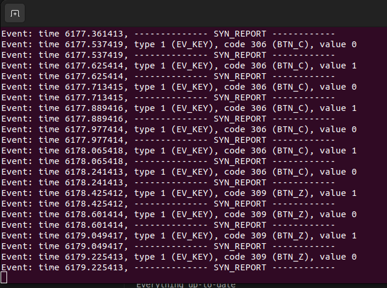

# Construire et essayer sur i.MX93 FRDM

## Préparer le noyau

Les patches du dépôt `linux-kernel-labs-imx93` s’appliquent, dans l’ordre, sur le tag Linux stable `v6.12.103`. Depuis la racine du dépôt, utiliser une copie de travail Linux propre.

```bash
lab_repo="$PWD"
kernel=/chemin/vers/linux
git -C "$kernel" switch --detach v6.12.103

for patch in "$lab_repo"/kernel-patches/*.patch; do
    git -C "$kernel" apply "$patch" || exit 1
done

export ARCH=arm64 CROSS_COMPILE=aarch64-linux-gnu-
make -C "$kernel" imx93_frdm_defconfig
make -C "$kernel" -j"$(nproc)" Image dtbs modules
make -C "$lab_repo" KDIR="$kernel"
```

Le premier patch reprend le support de base i.MX93 FRDM, adapté de celui fourni par Bootlin. Le deuxième ajoute la configuration du lab, l’intégration de Hello dans l’arbre noyau, le binding et le Device Tree du Nunchuk. Le troisième ajoute les broches et les nœuds de LPUART3 et LPUART8.

Démarrer la carte sur l’`Image` construite avec `arch/arm64/boot/dts/freescale/imx93-11x11-frdm-custom.dtb`. La formation décrit le démarrage via U-Boot et TFTP ainsi que le montage du système de fichiers via NFS. Copier les modules et les deux utilitaires sur la cible en conservant les répertoires `modules/` et `tools/`. [Formation Bootlin](https://bootlin.com/training/linux-kernel/)

## Essayer les modules sur la carte

Depuis le dossier où les fichiers ont été copiés, avec les droits root sur la cible.

### Module Hello

```bash
insmod modules/hello/hello_version.ko who=imx93
dmesg | tail
rmmod hello_version
dmesg | tail
```

La configuration du lab construit aussi `hello_version` comme module dans l’arbre du noyau (`CONFIG_HELLO_VERSION=m`). La commande ci-dessus charge la version compilée depuis ce dépôt.

### Joystick Nunchuk

Brancher le Nunchuk sur LPI2C4. Lancer `evtest`, choisir le périphérique **Wii Nunchuk**, puis actionner les boutons C/Z et déplacer le joystick. Les boutons produisent des événements `EV_KEY` et les axes des événements `EV_ABS`.

```bash
insmod modules/nunchuk/nunchuk.ko
evtest
# Après avoir quitté evtest
rmmod nunchuk
```



### Émission UART et compteur

Brancher l’adaptateur série sur l’UART à tester et ouvrir un terminal série à **115 200 bauds, 8N1**. Choisir le périphérique `/dev/serial-*` correspondant au port raccordé.

```bash
insmod modules/serial/serial.ko
ls /dev/serial-*
port=/dev/serial-0x0000000042570000
./tools/serial-reset-counter "$port"
./tools/serial-get-counter "$port"
printf 'Hello!\n' > "$port"
./tools/serial-get-counter "$port"
./tools/serial-reset-counter "$port"
./tools/serial-get-counter "$port"
rmmod serial
```

Dans l’essai du lab, **Minicom a affiché `Hello!`** et les outils ont indiqué successivement `Counter value: 0`, `Counter value: 7`, `Counter reset` puis `Counter value: 0`. Les sept octets comptés correspondent aux six caractères de `Hello!` et au saut de ligne qui termine l’écriture.
